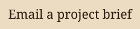
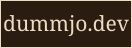

<!-- Hallmark · v2.0.0 · redesign: full, second pass · theme: blueprint, brownline sheet by request (Leonardo notebook) · dark: night sepia, derived · type: Cormorant Garamond by request, IBM Plex Mono for measurements · signature: a red-chalk cheetah in a circle and a square (after the Vitruvian figure), and the career as a dimension string, 2019 to 2026 · narrow viewBoxes with large type so the drawings stay readable at phone width · waive 20, 25, 34, 48, 77: GitHub owns the page CSS and sections · waive 80 and the second-colour do-not: the owner asked for an animal character and to keep Pac-Man, the typing line and the skill icons · waive scroll-following: a README runs no script, so the cheetah stands one station further in each section head · waive 49b: the client name Prima Transmission wraps at 320px and is not shortened · merged Field Record into Field Years and cut OT / IT Convergence to five rows: the owner asked for thin project detail -->
<picture>
  <source media="(prefers-color-scheme: dark)" srcset="https://raw.githubusercontent.com/dummJo/dummJo/main/assets/banner-dark.svg">
  <source media="(prefers-color-scheme: light)" srcset="https://raw.githubusercontent.com/dummJo/dummJo/main/assets/banner-light.svg">
  
</picture>

Electrical and automation engineer in Jakarta since 2019: drives, power, software.

  <a href="mailto:1437yb@gmail.com?subject=Project%20brief"><picture><source media="(prefers-color-scheme: dark)" srcset="https://raw.githubusercontent.com/dummJo/dummJo/main/assets/button-email-dark.svg"><source media="(prefers-color-scheme: light)" srcset="https://raw.githubusercontent.com/dummJo/dummJo/main/assets/button-email-light.svg"></picture></a>&nbsp;
  <a href="https://dummjo.dev"><picture><source media="(prefers-color-scheme: dark)" srcset="https://raw.githubusercontent.com/dummJo/dummJo/main/assets/button-site-dark.svg"><source media="(prefers-color-scheme: light)" srcset="https://raw.githubusercontent.com/dummJo/dummJo/main/assets/button-site-light.svg"></picture></a>

  <picture>
    <source media="(prefers-color-scheme: dark)" srcset="https://readme-typing-svg.demolab.com?font=Cormorant+Garamond&weight=600&size=24&duration=3200&pause=1100&color=ecdcc1&center=true&vCenter=true&width=640&lines=Vincinian+Engineer;ABB+Drive+Sizing+%26+Commissioning;Crane+Control%3A+Anti-Sway%2C+Load+Weighing%2C+STO;Power+Quality%3A+THD+Analysis+%26+Filter+Sizing;Builder+of+Engineering+Tools">
    <source media="(prefers-color-scheme: light)" srcset="https://readme-typing-svg.demolab.com?font=Cormorant+Garamond&weight=600&size=24&duration=3200&pause=1100&color=3c2111&center=true&vCenter=true&width=640&lines=Vincinian+Engineer;ABB+Drive+Sizing+%26+Commissioning;Crane+Control%3A+Anti-Sway%2C+Load+Weighing%2C+STO;Power+Quality%3A+THD+Analysis+%26+Filter+Sizing;Builder+of+Engineering+Tools">
    
  </picture>

<picture>
  <source media="(prefers-color-scheme: dark)" srcset="https://raw.githubusercontent.com/dummJo/dummJo/output/pacman-contribution-graph-dark.svg">
  <source media="(prefers-color-scheme: light)" srcset="https://raw.githubusercontent.com/dummJo/dummJo/output/pacman-contribution-graph.svg">
  
</picture>

 

<picture>
  <source media="(prefers-color-scheme: dark)" srcset="https://raw.githubusercontent.com/dummJo/dummJo/main/assets/header-projects-dark.svg">
  <source media="(prefers-color-scheme: light)" srcset="https://raw.githubusercontent.com/dummJo/dummJo/main/assets/header-projects-light.svg">
  
</picture>

- **[dummjo.dev](https://dummjo.dev)**, my site and dummVinci Lab
- **[PTTS Praxis](https://github.com/dummJo/DummVinci-Calculator)**, electrical sizing tools
- **[rosetta-plc](https://github.com/dummJo/dummvinci-rosetta-plc)**, PLC migration helper
- **Stadera**, a jastip tracker
- **Foto Kita Blur**, a browser camera toy
- **[Prima Transmission](https://github.com/dummJo/primatransmission-facelift)**, a client website
- a condition-monitoring dashboard prototype

<picture>
  <source media="(prefers-color-scheme: dark)" srcset="https://raw.githubusercontent.com/dummJo/dummJo/main/assets/header-toolbox-dark.svg">
  <source media="(prefers-color-scheme: light)" srcset="https://raw.githubusercontent.com/dummJo/dummJo/main/assets/header-toolbox-light.svg">
  
</picture>

  <picture>
    <source media="(prefers-color-scheme: dark)" srcset="https://skillicons.dev/icons?i=ts,js,py,bash,html,css,md,react,nextjs,nodejs,nestjs,tailwind,threejs,prisma,postgres,supabase,docker,linux,githubactions,vercel,git,github&perline=11&theme=dark">
    <source media="(prefers-color-scheme: light)" srcset="https://skillicons.dev/icons?i=ts,js,py,bash,html,css,md,react,nextjs,nodejs,nestjs,tailwind,threejs,prisma,postgres,supabase,docker,linux,githubactions,vercel,git,github&perline=11&theme=light">
    
  </picture>

  
  
  
  

| Field side (OT) | Software side (IT) |
| :--- | :--- |
| **Drives:** ABB `ACS580` commissioning, `ACS880` crane deployment | **Web:** `TypeScript`, `Next.js`, `Node.js`, `NestJS` |
| **Crane control:** `ACS880` + `N5050`, anti-sway, load weighing, STO | **Data:** `PostgreSQL`, `Prisma`, `Supabase` |
| **PLC:** Siemens and Allen-Bradley, SCADA and DCS integration | **Automation:** `n8n`, LLM APIs, `Python` |
| **Power quality:** THD analysis, filter sizing and quotation | **Infrastructure:** `Docker`, Linux, Vercel, GitHub Actions |
| **Electrical:** panel design, single-line diagrams, troubleshooting | **Scripting:** `Bash` |

<picture>
  <source media="(prefers-color-scheme: dark)" srcset="https://raw.githubusercontent.com/dummJo/dummJo/main/assets/header-years-dark.svg">
  <source media="(prefers-color-scheme: light)" srcset="https://raw.githubusercontent.com/dummJo/dummJo/main/assets/header-years-light.svg">
  
</picture>

| Year | Milestone |
| :---: | :--- |
| **2018** | Casio Thailand, four-month industrial internship |
| **2019** | Electrical engineer on job sites across Java |
| **2020** | First solo VSD commissioning, an ABB `ACS580` |
| **2022** | `ACS880` + `N5050` crane control in Cilegon |
| **2023 to present** | Control-system and DCS integration |
| **2024** | Channel Partner Expert Day in Shanghai, representing PTTS |
| **2025 to present** | Presales engineer and system integrator at PTTS; operations automation with `n8n` |
| **Ongoing** | Power quality: active filters and voltage conditioners |

<picture>
  <source media="(prefers-color-scheme: dark)" srcset="https://raw.githubusercontent.com/dummJo/dummJo/main/assets/header-bench-dark.svg">
  <source media="(prefers-color-scheme: light)" srcset="https://raw.githubusercontent.com/dummJo/dummJo/main/assets/header-bench-light.svg">
  
</picture>

  <picture>
    <source media="(prefers-color-scheme: dark)" srcset="https://github-readme-stats.shion.dev/api?username=dummJo&show_icons=true&rank_icon=github&bg_color=2a1c10&title_color=ecdcc1&text_color=ecdcc1&icon_color=ecdcc1&border_color=ecdcc1&border_radius=0">
    <source media="(prefers-color-scheme: light)" srcset="https://github-readme-stats.shion.dev/api?username=dummJo&show_icons=true&rank_icon=github&bg_color=e1ceb0&title_color=3c2111&text_color=6b4e3a&icon_color=3c2111&border_color=3c2111&border_radius=0">
    
  </picture>
  <picture>
    <source media="(prefers-color-scheme: dark)" srcset="https://github-readme-stats.shion.dev/api/top-langs/?username=dummJo&layout=compact&bg_color=2a1c10&title_color=ecdcc1&text_color=ecdcc1&border_color=ecdcc1&border_radius=0">
    <source media="(prefers-color-scheme: light)" srcset="https://github-readme-stats.shion.dev/api/top-langs/?username=dummJo&layout=compact&bg_color=e1ceb0&title_color=3c2111&text_color=6b4e3a&border_color=3c2111&border_radius=0">
    
  </picture>
  <picture>
    <source media="(prefers-color-scheme: dark)" srcset="https://streak-stats.demolab.com/?user=dummJo&background=2a1c10&border=ecdcc1&border_radius=0&stroke=ecdcc1&ring=ecdcc1&fire=ecdcc1&currStreakNum=ecdcc1&currStreakLabel=ecdcc1&sideNums=ecdcc1&sideLabels=ecdcc1&dates=ecdcc1">
    <source media="(prefers-color-scheme: light)" srcset="https://streak-stats.demolab.com/?user=dummJo&background=e1ceb0&border=3c2111&border_radius=0&stroke=3c2111&ring=3c2111&fire=3c2111&currStreakNum=3c2111&currStreakLabel=3c2111&sideNums=3c2111&sideLabels=6b4e3a&dates=6b4e3a">
    
  </picture>

<picture>
  <source media="(prefers-color-scheme: dark)" srcset="https://raw.githubusercontent.com/dummJo/dummJo/main/assets/header-contact-dark.svg">
  <source media="(prefers-color-scheme: light)" srcset="https://raw.githubusercontent.com/dummJo/dummJo/main/assets/header-contact-light.svg">
  
</picture>

Have a drive to commission, a power quality problem, or an OT/IT bridge that has to hold? Send a short brief with the site, the equipment, and what has to work.

<a href="mailto:1437yb@gmail.com?subject=Project%20brief"><picture><source media="(prefers-color-scheme: dark)" srcset="https://raw.githubusercontent.com/dummJo/dummJo/main/assets/button-email-dark.svg"><source media="(prefers-color-scheme: light)" srcset="https://raw.githubusercontent.com/dummJo/dummJo/main/assets/button-email-light.svg"></picture></a>

*Bahasa Indonesia:* kirim ringkasan singkat: lokasi, peralatan, dan apa yang harus berjalan.

Need ABB drives, panels or service supplied? That runs through my day job at PTTS, an ABB Authorized Value Provider: (021) 629 3028, [ptts.co.id](https://ptts.co.id). In 2023 ABB published [a story on PTTS](https://new.abb.com/news/detail/110834/abb-ability-mobile-connect-helps-ptts-bring-value-and-peace-of-mind-to-indonesian-customers) about remote drive commissioning support with ABB Ability™ Mobile Connect. This profile is personal, not an official PTTS channel.

Based in Jakarta, working on site or remote. [LinkedIn](https://linkedin.com/in/1437yb), [dummjo.dev](https://dummjo.dev).

<picture>
  <source media="(prefers-color-scheme: dark)" srcset="https://raw.githubusercontent.com/dummJo/dummJo/main/assets/footer-dark.svg">
  <source media="(prefers-color-scheme: light)" srcset="https://raw.githubusercontent.com/dummJo/dummJo/main/assets/footer-light.svg">
  
</picture>
